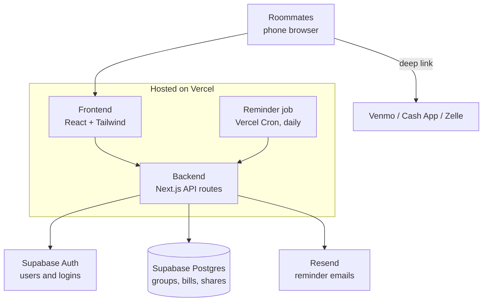

# Nudge

Nudge is a mobile-first web app for roommates (or any group) to track shared bills, split them flexibly, and get paid back through Venmo, Cash App, or Zelle, with automatic reminders so nobody has to chase anyone.

> **Current state: demo mode.** There is no backend yet. You sign in with just a name, Jay, Rob and Leo are pre-made friends, and everything lives in memory, so reloading the page wipes it. The architecture below is the planned production setup.

**Live demo:** https://nudge-theta-lemon.vercel.app/

## Run it

```
npm install
npm run dev
```

Open http://localhost:3000 in a phone-width window.

## How it works

1. **Sign in and add payment handles.** Each person saves their Venmo username, Cash App $cashtag, and/or Zelle email or phone. Roommates only see the options you fill in.
2. **Make groups.** A group is an apartment, a trip, or anyone you split costs with. The Groups page lists every group you're in, with your balance in each. Tap one to go in, and use the back arrow to return.
3. **Add a bill.** Enter the total, who paid, and who's splitting. Split it equally, by exact amounts, or by percent. Nudge checks the shares add up to the total before saving.
4. **Pay a roommate.** Nudge opens a prefilled Venmo or Cash App link, or shows a copyable Zelle handle and the exact amount. The payment itself happens in that app, since Nudge never moves money.
5. **Mark and confirm.** The person who owes taps "I've paid", then whoever fronted the bill confirms it. Each share moves from Waiting to Marked paid to Confirmed.
6. **Reminders.** Roommates get an email when a bill is added, and a daily nudge while they still owe.

Nudge stores only the public handles people choose to share, never bank accounts, cards, or payment app logins. Money is tracked in whole cents.

## Planned architecture



| Layer | Technology |
| --- | --- |
| Frontend and backend | Next.js (React), TypeScript, Tailwind CSS in one project |
| Auth | Supabase Auth, email magic links |
| Database | Supabase (PostgreSQL) |
| Email | Resend |
| Scheduled jobs | Vercel Cron |
| Hosting | Vercel |
| Payments | Venmo, Cash App, Zelle via links (hand-off only) |
